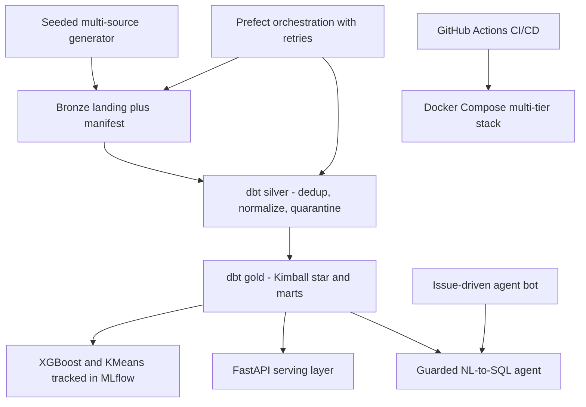

# OpsTwin

[](https://github.com/srivastavnilesh/opstwin/actions/workflows/ci.yml)
[](https://github.com/srivastavnilesh/opstwin/actions/workflows/ask-opstwin.yml)
[](requirements.txt)
[](src/warehouse)
[](src/platform)

AI-first operations intelligence platform for multi-site built assets.
Ingest, warehouse, predict, serve, and ask in plain English.

---

## Interact with OpsTwin

This repository is not a static portfolio piece. It answers questions.

### Ask OpsTwin directly on GitHub (zero setup)
1. Open a new Issue titled `Ask: <your business question>` — for example `Ask: Which vendor has the highest SLA breach percentage?`
2. Write the question in the Issue body.
3. Within about three minutes the agent replies in-thread with the exact read-only SQL it executed, the result table, and a plain-English summary.

Guardrails are enforced in CI: SELECT/WITH only, table allowlist, read-only DuckDB connection, 500-row cap. Destructive or out-of-scope requests are refused publicly, on the record.

<details>
<summary>Example exchange</summary>

**Issue:** `Ask: Which site generated the most total revenue?`

**Agent-executed SQL:**

```sql
SELECT s.site_id, SUM(b.revenue_inr) AS total_revenue
FROM gold.fact_bookings b
JOIN gold.dim_site s ON b.site_key = s.site_key
GROUP BY s.site_id ORDER BY total_revenue DESC LIMIT 1
```

| site_id | total_revenue |
|---|---|
| HYD-OLD-001 | 58876004.0 |

*The top-earning location is Asaf Jah Haveli (HYD-OLD-001), generating the highest total revenue across all sites.*
</details>

### Live API in 30 seconds (local)

```bash
uvicorn src.serving.api:app --port 8000
# Swagger UI at http://127.0.0.1:8000  — execute /predict live
```


### Ask from your terminal

```bash
python -m src.agent.ask "Which assets show the worst vibration trends this quarter?"
```

---

## What OpsTwin is

OpsTwin turns raw, messy operational data from a three-site built-asset portfolio (heritage hospitality and commercial coworking) into guarded, agentic insight. It solves the last-mile problem of data engineering: moving from unreliable telemetry and free-text maintenance logs to reconciled marts that a non-technical founder can query in plain English — with every transformation mathematically accounted for.

## Architecture



| Stage | Implementation | Evidence |
|---|---|---|
| Ingestion | 4 sources: IoT telemetry, Postgres operational DB, unstructured maintenance notes, vendor SLA feeds | 633,243 telemetry rows, 72 hive partitions, SHA-256 manifest |
| Warehouse | dbt on DuckDB: 7 staging views, silver cleaning chain, Kimball star (5 dims, 4 facts), 3 business marts | 26 models, 39 data tests, 3 seeds — 68/68 PASS |
| Orchestration | Prefect flow: generate → dbt build → profile, with retries and strict dependencies | Self-healing run logs committed to `outputs/logs/` |
| Machine learning | KMeans health segmentation, XGBoost failure-risk model, dual-run leakage audit in MLflow | Sanity run vs ground-truth run compared side by side |
| Serving | FastAPI with async lifespan model loading, Pydantic validation, OpenAPI docs | 2 integration tests, live Swagger UI |
| Agentic AI | Gemini NL-to-SQL with read-only connection, allowlist, row cap, self-repair loop | 6 guardrail unit tests, deterministic eval harness |
| Platform | Docker Compose multi-tier stack, slim serving image, healthchecks, restart policies | Kill-the-container self-heal demo, CI docker build |

## The evidence ledger

Defects are injected at known rates by the generator so the validation layer has provable work. Nothing is dropped silently.

| Row reconciliation | Rows |
|---|---|
| Bronze ingested | 633,243 |
| Duplicates removed | 2,523 |
| Deduped | 630,720 |
| Quarantined (null value) | 9,363 |
| Silver clean | 621,357 |
| Balances | true |

| Injected defect | Rate | Observed in bronze | Remaining in silver |
|---|---|---|---|
| Nulls | 1.5% | 9,404 | 0 |
| Duplicates | 0.4% | 2,523 | 0 |
| Unit drift (Fahrenheit) | 1.0% | 1,552 | 0 |
| Late arrivals | 2.0% | 12,673 | flagged, retained |
| Outliers | 0.2% | n/a | 4,384 flagged, retained |

Outliers are flagged, never deleted — a spike may be a real failure in progress. Full ledger: [`outputs/reports/phase2_profile.md`](outputs/reports/phase2_profile.md).

## Guarded agent design

- Read-only DuckDB connection; the agent physically cannot write.
- SELECT/WITH only; forbidden-keyword blocklist with word-boundary matching.
- Table allowlist limited to marts and gold tables; CTE-aware so legitimate queries pass.
- Single-statement enforcement; 500-row cap wrapper.
- One self-repair round on SQL error, then refusal with a stated reason.
- Deterministic eval harness scores agent SQL against ground-truth queries; results committed to `outputs/manifests/phase6_agent_eval.json`.

## Platform and reliability

- `docker compose` multi-tier stack (Postgres + API) with healthchecks and `restart: unless-stopped`; killing the API container brings it back automatically.
- Slim serving image: `.dockerignore` cut the build context from 441 MB to a few MB; `libgomp1` pinned for XGBoost on debian-slim.
- GitHub Actions: lint → pytest → docker build on every push; a second workflow powers the Issue-driven agent bot.
- Every phase writes a committed, timestamped run log — the analysis is reproducible and auditable.

## Quality gates

| Gate | Scope | Status |
|---|---|---|
| pytest | 19 tests: scaffold invariants, Phase 1 determinism, API integration, agent guardrails | passing |
| dbt | 68 nodes: 26 models, 39 tests, 3 seeds, incl. row-loss and reconciliation invariants | PASS |
| ruff | E, F, I, PIE rule sets across src, tests, config | clean |
| Reconciliation | bronze = silver + quarantine + duplicates removed | balances: true |
| CI/CD | lint, test, docker build on push | green |

## Repository structure

```text
opstwin/
├── config.py                    # single source of truth
├── Makefile                     # bootstrap, verify, lint, test
├── requirements*.txt            # core, dev, serving stacks
├── .github/workflows/           # ci.yml, ask-opstwin.yml (issue bot)
├── scripts/                     # bootstrap, verify, phase runners, issue_agent
├── src/
│   ├── data/generate.py         # seeded multi-source generator
│   ├── warehouse/               # dbt project + profiler
│   │   ├── models/{staging,silver,gold,marts}
│   │   ├── seeds/               # sites, vendors, sla_targets
│   │   └── profile_warehouse.py # defect ledger + reconciliation
│   ├── flows/orchestration.py   # Prefect pipeline
│   ├── ml/train_models.py       # KMeans + XGBoost + MLflow dual-run audit
│   ├── serving/api.py           # FastAPI with lifespan model loading
│   ├── agent/                   # guards, schema context, ask, evals
│   └── platform/                # compose.yml, Dockerfile.api
├── app/                         # dashboard layer (Phase 8)
├── tests/                       # 19 pytest tests
└── outputs/                     # committed manifests, logs, reports
```

## Quickstart

```bash
git clone https://github.com/srivastavnilesh/opstwin.git && cd opstwin
python3.12 -m venv .venv && source .venv/bin/activate
pip install -r requirements.txt -r requirements-dev.txt

python src/flows/orchestration.py        # generate -> dbt build -> profile
python -m src.ml.train_models            # dual-run MLflow leakage audit
uvicorn src.serving.api:app --port 8000  # API + Swagger UI
python -m src.agent.ask "Which site generated the most total revenue?"
```

Warehouse lineage and column-level docs: `dbt docs generate && dbt docs serve` from `src/warehouse`.

## Provenance

Third chapter of a built-asset intelligence lineage: the SVNIT digital-twin audit engine (statutory gating, capex contingency, egress checks), the Asset-Hospitality-Management underwriting OS (lease-horizon DCF, lever pricing), and now OpsTwin — the production platform that unifies both into data, ML, and agentic layers.

---

Built by **Nilesh Srivastav** — Final Year Civil Engineering, SVNIT Surat.
[LinkedIn](https://www.linkedin.com/in/srivastav-nilesh-4b909b446) · Every engine ships with committed logs, tests, and a live interface.